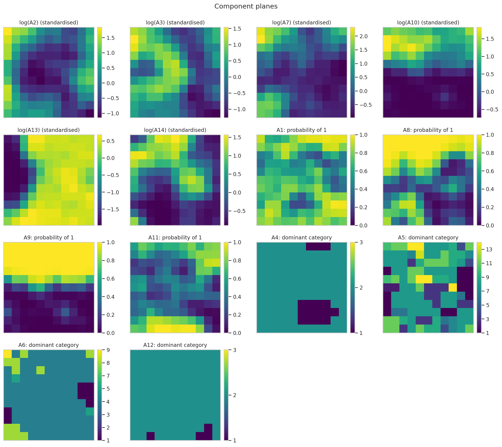
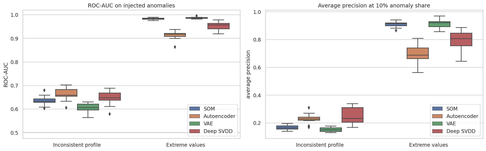
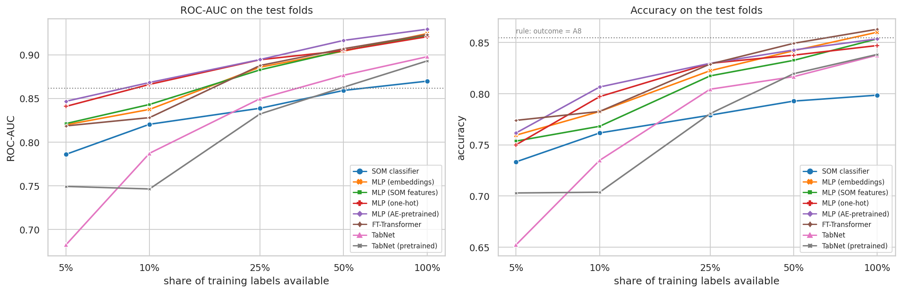

# 🗺️ Fraud Screening | Self-Organizing Maps

> **Unsupervised anomaly detection for credit card applications: a Self-Organizing Map compared with Autoencoder, VAE and Deep SVDD, plus a semi-supervised study with scarce labels**




---

## 🔰 Overview
This project builds a **screening system that ranks credit card applications by how atypical they are**, so that unusual ones can be sent to manual review.  
The data contains no fraud labels, so the task is framed as **unsupervised anomaly detection**, and every result is stated in terms of *potentially* fraudulent applications.

A **Self-Organizing Map (SOM)**, implemented from scratch in NumPy and validated against MiniSom, is the central model. It is compared with three neural detectors:

- 🧠 Autoencoder  
- 🎲 Variational Autoencoder (VAE)  
- 🎯 Deep SVDD  

The project has two main parts:
1. **Section A · Unsupervised fraud screening** → SOM training and map analysis, anomaly scores with per-attribute explanations, and a comparison of the four detectors on a controlled benchmark, on stability across seeds and on agreement.  
2. **Section B · Semi-supervised learning with scarce labels** → how much unsupervised structure (SOM, autoencoder pretraining, TabNet pretraining) helps a classifier when only 5% to 100% of the training labels are available.  

---

## 📦 Dataset
The experiments use a credit card application dataset published on Kaggle:  
👉 [Credit Card Applications](https://www.kaggle.com/datasets/mbsoroush/credit-cards-applications)

- **690** anonymised applications, no missing values, no duplicates  
- **14 attributes** (`A1`–`A14`): 6 numeric, 4 binary and 4 categorical (3 to 14 levels)  
- `Class`: the outcome of each application (44.5% positive). It is a credit decision, **not a fraud label**: it is never used for training in Section A and is the prediction target in Section B  
- `CustomerID` is an identifier and is not used by any model  

The data follows the structure of the Statlog (Australian Credit Approval) dataset: R. Quinlan (1987), *Statlog (Australian Credit Approval)*, UCI Machine Learning Repository, [doi:10.24432/C59012](https://doi.org/10.24432/C59012) (CC BY 4.0).

---

## ⚙️ Installation
Clone the repository and install dependencies:

```bash

git clone https://github.com/mbsoroush/FraudScreeningSOM.git
cd FraudScreeningSOM
pip install -r requirements.txt

```

## 🚀 Usage

To run the experiment locally:

1. ✅ Place `Credit_Card_Applications.csv` in the project folder  
2. ✅ Run the following command:  

   ```bash
   jupyter notebook fraud-screening-self-organizing-maps.ipynb
   ```

3. ✅ Run all cells  

On Kaggle: add the dataset as input, enable a GPU and internet access, and run all cells (about **40 minutes**: roughly 15 minutes for Section A and 20-25 minutes for Section B).

Trained models and result tables are saved to an `artifacts/` folder together with a manifest of the data hash and the configuration. Later runs with the same data and configuration reuse them instead of training again.

---

## 🧹 Preprocessing Steps

Before modelling, the application data went through the following steps:

1. ✅ **Cleaning**  
   - 690 rows, no missing values, no duplicate rows  
   - `CustomerID` dropped, `Class` excluded from every Section A model  

2. ✅ **Encoding** (38 model inputs)  
   - All 6 numeric attributes are strongly right-skewed and are transformed with `log(1 + x)`, then standardised  
   - The 4 categorical attributes are one-hot encoded (28 columns)  
   - The 4 binary attributes are scaled by √2, so that every attribute type contributes a comparable squared distance (2 for a mismatch)  

3. ✅ **Scaling (no leakage)**  
   - The encoder is refitted on the training folds only in every cross-validation  

4. ✅ **Splitting**  
   - Section A benchmark: 5-fold cross-validation repeated 3 times  
   - Section B: stratified 5-fold cross-validation repeated twice, with nested, stratified label subsets of 5%, 10%, 25%, 50% and 100% of each training fold  
   - Unsupervised stages see all training rows of a fold without labels, and the test fold is never used before the final prediction  

---

📌 After preprocessing, the data was ready for training on every model.

## 🧠 Model Training Steps

All neural models were trained on Kaggle with GPU acceleration (one of the two T4 GPUs is used).  
Below are the main steps:

1. ✅ **Model Selection**  
   - Section A: SOM + Autoencoder + VAE + Deep SVDD  
   - Section B: SOM classifier, MLP (embeddings), MLP (SOM features), MLP (one-hot), MLP (autoencoder-pretrained), FT-Transformer, TabNet, TabNet (pretrained)  

2. ✅ **SOM Setup**  
   - Online training, Gaussian neighbourhood, asymptotic decay  
   - 11 × 11 grid (rule of thumb of about 5√N neurons), radius 2.0, learning rate 0.5, 100 epochs  
   - Radius and learning rate selected by held-out quantization and topographic error  
   - Anomaly score = distance to the best-matching neuron  

3. ✅ **Neural Detectors**  
   - Fixed architectures with an 8-dimensional bottleneck, trained without labels  
   - Not tuned on the benchmark, so the comparison does not favour any detector  

4. ✅ **Evaluation Without Fraud Labels**  
   - Synthetic anomalies injected into held-out applications: **inconsistent profiles** (4 of 14 attributes replaced by values of other applications) and **extreme values** (2 numeric attributes raised to 1.5-3 times their 99th percentile)  
   - Metrics: ROC-AUC and average precision at a 10% anomaly share  
   - Stability across 10 seeds and agreement between detectors  

5. ✅ **Semi-Supervised Setup (Section B)**  
   - AdamW with a fixed budget of optimiser steps and fixed hyperparameters (no validation set when labels are scarce)  
   - Metrics: ROC-AUC and accuracy on the test folds  
   - Paired gains for the pairs that differ only in the unsupervised stage  

---

📌 After training, every detector was scored on the same applications, and the SOM was analysed with maps, component planes and per-application drivers.

## 📊 Results

### Section A · Detectors on injected anomalies (5-fold CV × 3 repeats)

| Detector | ROC-AUC, extreme values | ROC-AUC, inconsistent profiles | Stability across seeds (rank correlation) | Overlap of flagged top 5% |
|---|---|---|---|---|
| **SOM** | 0.984 | 0.636 | 0.81 | 0.47 |
| Autoencoder | 0.914 | 0.665 | 0.66 | 0.22 |
| VAE | **0.987** | 0.606 | **0.98** | **0.70** |
| Deep SVDD | 0.952 | 0.649 | 0.29 | 0.12 |



**Key findings**

1. ✅ All detectors recognise implausibly **large values**; the SOM (0.984) and the VAE (0.987) are best  
2. ✅ Unusual **combinations of attributes** are hard to detect (ROC-AUC 0.61 to 0.67): most attributes in this dataset are nearly independent  
3. ✅ The SOM ranks applications consistently overall, but **about half of its flagged set changes between seeds**, so averaging several seeds is recommended  
4. ✅ The SOM and the VAE agree most (rank correlation 0.85, 66% overlap of flagged sets)  
5. ✅ SOM performance hardly depends on the grid size (6 × 6 to 24 × 24)  
6. ✅ No detector is clearly superior: mean ROC-AUC lies between 0.79 and 0.81 for all four  

### Section B · Label efficiency (ROC-AUC on the test folds, mean over 10 splits)

| Model | 5% labels | 10% | 25% | 50% | 100% |
|---|---|---|---|---|---|
| SOM classifier | 0.786 | 0.820 | 0.839 | 0.859 | 0.870 |
| MLP (embeddings) | 0.820 | 0.837 | 0.886 | 0.904 | 0.924 |
| MLP (SOM features) | 0.821 | 0.843 | 0.883 | 0.905 | 0.922 |
| MLP (one-hot) | 0.841 | 0.866 | 0.894 | 0.905 | 0.921 |
| MLP (autoencoder-pretrained) | **0.847** | **0.868** | **0.894** | **0.916** | **0.929** |
| FT-Transformer | 0.819 | 0.828 | 0.888 | 0.907 | 0.923 |
| TabNet | 0.682 | 0.787 | 0.850 | 0.876 | 0.898 |
| TabNet (pretrained) | 0.749 | 0.746 | 0.832 | 0.863 | 0.893 |



For reference, the fixed rule "outcome = A8" reaches a ROC-AUC of 0.862 and an accuracy of 0.855 without any labels. It was chosen after inspecting the data and is therefore an optimistic baseline.

**Key findings**

1. ✅ Small **MLPs are the most label-efficient** models: with 55 labeled applications (10%) they match the ranking quality of the single-attribute rule  
2. ✅ The autoencoder-pretrained MLP is the best model at every label fraction, by margins comparable to the variation between splits  
3. ✅ The **FT-Transformer does not improve on the MLPs**, and **TabNet is clearly worse when labels are scarce** (0.682 at 5%)  
4. ✅ **Unsupervised structure gives at most small gains**: SOM features add nothing, autoencoder pretraining gives up to +0.012 ROC-AUC, and TabNet pretraining is inconsistent  
5. ✅ The SOM classifier trails the MLPs (0.786 to 0.870) but trains in seconds and every prediction can be traced to a neuron on the map  

---

📌 For this dataset, the SOM is a competitive and interpretable screening model, while a single attribute carries most of the signal for the supervised task.

## 🔮 Example Screening Output

Here's what the screening result looks like:

1. ✅ **Input**  
   - One application with its 14 attributes, for example the highest-scoring one (`CustomerID` 15790113), which has the largest `A14` value in the data (100,001)  

2. ✅ **Model Processing**  
   - The application is encoded into 38 inputs and mapped to its best-matching neuron on the 11 × 11 map  

3. ✅ **Prediction Output**  
   - 📊 Anomaly score → `3.40` (the top-5% threshold is about 2.5)  
   - 🔎 Main drivers → `A14, A12, A4`  
   - ✅ Outcome in the data → approved, so the application enters the review queue  

4. ✅ **Overall**  
   - 35 of 690 applications (5%) are flagged, and 19 of them were approved  

---

📌 The score is a ranking for manual review, not a verdict: it indicates that an application deviates from its closest prototype, and the drivers show where.

## 🧪 Troubleshooting

Common issues and their solutions when running the project:

1. ❌ **`FileNotFoundError` for `Credit_Card_Applications.csv`**  
   - Cause: The dataset is not among the inputs or in the project folder  
   - ✅ Solution:  
     - Place the CSV next to the notebook, or add the dataset as a Kaggle input  

2. ❌ **MiniSom cross-check or TabNet models skipped**  
   - Cause: `minisom` or `pytorch-tabnet` could not be installed (internet access disabled)  
   - ✅ Solution:  
     - Enable internet access, or install both packages with `pip install -r requirements.txt`  

3. ❌ **Run takes too long**  
   - Cause: SOM search, 10 seeds per detector, and 10 splits × 5 label fractions × 8 models in Section B  
   - ✅ Solution:  
     - Set `QUICK_RUN = True` for a fast check of the pipeline (reduced settings, not meant for reporting), or run on a GPU  

4. ❌ **Results differ slightly from the README**  
   - Cause: GPU operations are not fully deterministic, even with fixed seeds  
   - ✅ Solution:  
     - Small variations are expected; conclusions should stay the same  

5. ❌ **Models are trained again although `artifacts/` exists**  
   - Cause: The data or the configuration changed, so the manifest no longer matches  
   - ✅ Solution:  
     - This is intended; set `FORCE_RETRAIN = True` to retrain everything on purpose  

6. ❌ **CUDA warnings in the logs**  
   - Cause: Normal PyTorch startup messages  
   - ✅ Solution:  
     - They are harmless and can be ignored  

---

📌 Following these steps should resolve most issues encountered when running the notebook.

## 📦 Deliverables

The project includes the following components:

1. ✅ Experiment notebook → `fraud-screening-self-organizing-maps.ipynb`  
2. ✅ Dependencies → `requirements.txt`  
3. ✅ Generated results → `artifacts/` (benchmark, stability and label-efficiency tables, saved SOM and neural models)  
4. ✅ Figures → `figures/` (maps, component planes, benchmark and label-efficiency plots)  
5. ✅ Dataset → credit card applications on Kaggle (`credit-cards-applications`)  

---

## 🏁 Conclusion

1. ✅ **Objective Achieved**  
   - Built an interpretable screening model for credit card applications and compared it with three neural detectors without fraud labels  

2. ✅ **Key Features**  
   - SOM implemented from scratch and validated against MiniSom  
   - Controlled benchmark with injected anomalies, stability across seeds and agreement between detectors  
   - Per-application explanations: every flag lists the attributes that drive it  
   - Semi-supervised study of label efficiency with paired comparisons  

3. ✅ **Impact**  
   - Shows that a SOM is a competitive and interpretable screening model, and that a single run is not fully reliable: scores should be averaged over several seeds  

4. ✅ **Limitations**  
   - No fraud labels: Section A relies on synthetic anomalies, and Section B predicts a credit decision, which is not fraud  
   - 690 applications and 14 anonymised attributes: differences between models are often within the variation between folds  
   - Neural models use fixed, untuned hyperparameters; the SOM radius and learning rate were selected on all applications (without labels) before the benchmark  
   - The reference rule on `A8` was chosen after inspecting the data  

5. ✅ **Future Improvements**  
   - Evaluation on a dataset with confirmed fraud labels  
   - An ensemble of SOMs trained with different seeds as the screening score  
   - An explanation layer for the neural detectors for a like-for-like comparison with the SOM  

---

📌 With this project, we showed that an **interpretable SOM** can match neural detectors for application screening, and that **careful evaluation** matters more than model complexity.

## ⚖️ License

This project is licensed under the [GNU General Public License v3.0](https://github.com/mbsoroush/FraudScreeningSOM/blob/main/LICENSE).  
You are free to use, modify and distribute the code under the terms of the GPL-3.0; derivative works must be released under the same license.

The dataset is not covered by this license: it remains subject to the terms of its original source (UCI Machine Learning Repository, CC BY 4.0).
